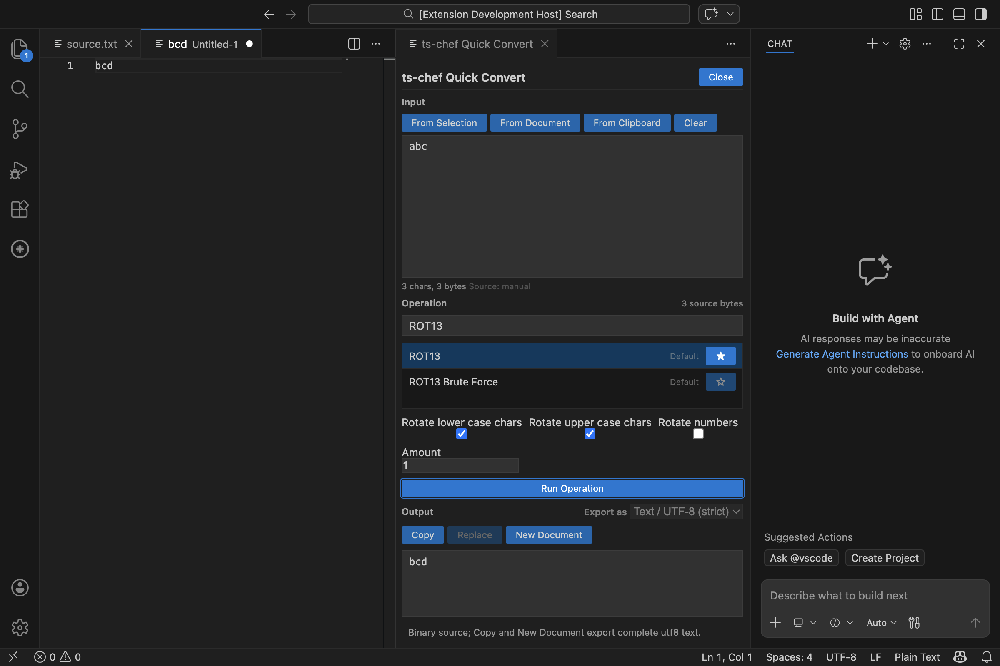

# Quick Workbench

Run **tschef: Open Quick Workbench** from the Command Palette. It opens a panel beside your editor for a single transformation, without changing your saved recipes or pipelines.

## Decode a selection

1. Put `SGVsbG8=` in a text editor and select it.
2. Open Quick Workbench and choose **From Selection**. The source is the last explicitly focused, still visible editor, even after the panel receives focus.
3. Search for **From Base64** and select it. Its alphabet and strict-mode parameters appear below the operation list.
4. Safe operations with default parameters preview automatically for small inputs. After changing a parameter, choose **Run Operation**. Expensive or networked operations always require an explicit run.
5. The output is `Hello`. **Export as** identifies the representation used by **Copy** and **New Document**.
6. Choose **Copy** to export the complete result, or **New Document** to open it in the first editor group.
7. For selection input, **Replace** changes the original captured range once. Changing your selection later does not redirect the edit. Changing or closing the original document invalidates replacement.

Manual input, **From Document**, and **From Clipboard** also work. An empty input is a valid input; a missing source editor is an error. Stars persist favorites between openings, and recent successful operations appear first.

## Parameters and keyboard use

All 15 argument types present in the operation catalog have editors, including presets that populate other fields, encoding toggles, section labels and selectors that enable dependent parameters. Unsupported metadata produces a visible error instead of guessing a type.

Use Tab to move through inputs, operation rows, favorite buttons, parameters and actions. Enter or Space selects a focused operation; Enter activates a focused Run button. Editing input or parameters immediately disables exports until a fresh execution succeeds. Errors keep exports disabled.

For AES Encrypt, **Input: UTF8** encodes Unicode text. **Raw** means byte characters (0–255) and refuses wider Unicode; use **Hex** for arbitrary bytes. AES Decrypt offers strict **Output: UTF8**, plus **Raw** and **Hex**. GCM encryption includes a separate `Tag:` line: enter that tag in AES Decrypt's GCM Tag field and supply the same additional authenticated data.

## Output and limits

The original result remains separate from its preview. Byte arrays, Buffers and ArrayBuffers remain binary even when they contain valid UTF-8. Choose:

- **Text / UTF-8 (strict)**: original strings, or strictly decoded bytes. Invalid UTF-8 switches visibly to **Hex**, retaining every byte.
- **Hex**: all bytes as hexadecimal text.
- **Base64**: all bytes as Base64 text.

Copy and New Document export the complete selected textual representation, never clipboard binary objects or a shortened preview. Replace is available only for text/UTF-8 output from a captured selection.

| Limit | Value |
| --- | --- |
| Automatic input | 65,536 UTF-16 code units |
| Automatic output | 4,194,304 bytes |
| Manual/source input | 16,777,216 UTF-16 code units |
| Full manual output | 52,428,800 bytes |
| Displayed preview | 100,000 UTF-16 code units |

Output limits are checked before cloning and encoding the returned result. They cannot bound memory allocated inside an operation beforehand. Long-running manual operations share the extension host; no hard CPU timeout or OS memory sandbox is promised. Use modest inputs for decompression, generation and expensive analysis.

The screenshot comes from the real local VS Code UI test, not a mockup.
